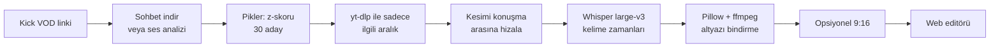

# createclip

**Kick VOD linkini yapıştır → en iyi anları bulsun, klipleri kessin, Türkçe kelime kelime altyazı bassın, istersen 9:16'ya çevirsin.**
Her klip web arayüzünde düzenlenebilir. Her şey yerelde çalışır (Apple Silicon Mac), buluta video veya ses yüklenmez.

> *Paste a Kick VOD link → finds the best moments from chat activity, cuts clips, burns word-by-word Turkish captions
> (local Whisper) and can reframe to 9:16. Local web editor + CLI.*


## Özellikler
- **An bulma:** sohbet yoğunluğu (eşsiz sohbetçi sayısı, emote'lara düşük ağırlık, yayının ortalamasına göre z-skoru) ya da ses seviyesi.
- **Altyazı:** `mlx-whisper large-v3` ile kelime zamanlı Türkçe altyazı; aktif kelime vurgulu, 3 font, renk/kontur/boyut/konum ayarı, küfür maskesi.
- **9:16:** bulanık arka plan, tek pencere, iki pencere (üst/alt); pencereleri kareye tıklayarak elle seçersin.
- **Üretmeden önce ayar + canlı önizleme**, ön ayar kaydetme (ör. "Shorts").
- **Düzenlenebilir klipler:** kesimi ±1 sn ayarla, metni düzelt (zamanlama korunur), senkron kaydırıcısı, klip ekle/sil, skora göre sıralama.
- Altyazılı **ve** altyazısız sürüm, `.srt` dışa aktarma.

| Altyazı fontları (önizleme) | 9:16 |
|---|---|
|  |  |

## Gereksinimler
`ffmpeg`, `yt-dlp`, `curl` (`brew install ffmpeg yt-dlp`), Python 3.10+. İlk altyazıda
`mlx-community/whisper-large-v3-mlx` (~3 GB) indirilir; ayrı hizalama modeli gerekmez.

## Kurulum
```bash
git clone https://github.com/emirhan-coban/createclip.git
cd createclip && python3 -m venv .venv && ./.venv/bin/pip install -e ".[dev]"
```

## Kullanım
Web arayüzü (önerilen):
```bash
./.venv/bin/createclip serve          # http://127.0.0.1:8765
```
Komut satırı:
```bash
./.venv/bin/createclip run "<kick-linki>" -n 5                        # altyazılı + altyazısız
./.venv/bin/createclip run "<link>" --layout stack --mask-profanity   # 9:16 iki pencere, küfür yıldızlı
./.venv/bin/createclip run "<link>" --at 1:44:50 --at 0:27:50-0:28:40 # elle zamanlar (sohbet gerekmez)
./.venv/bin/createclip run "<link>" --source audio                    # sohbet yerine ses seviyesi
./.venv/bin/createclip run "<link>" --full-chat --size 0.06 --ypos 0.7 --chunk 2 --sync -0.1 --max-height 1080
```
Çıktı `output/<kanal>-<vod>/` altında: `clips/` (altyazısız), `captioned/` (altyazılı), `words/` (`.json`, `.srt`),
`raw/` (kenar payı olan ham kesit), `chat.jsonl` (önbellek), `manifest.json`.

## Sohbet indirme süreleri (ölçüldü)
2,5 saatlik bir yayında (~16 bin mesaj):

| Mod | Süre | Mesaj |
|---|---|---|
| Hızlı (5 sn'de bir istek) | 18,4 dk | 16 080 (%98) |
| Tam (yoğun anlar dahil) | 19,6 dk | 16 449 |
| Ses seviyesi (`--source audio`) | internet hızına bağlı (ölçülmedi) | sohbet yok |

Süreyi Kick'in hız sınırı (`HTTP 429`, 4 paralel istekte bile) belirler; bu yüzden hızlı/tam farkı küçüktür.
Gerçekten hızlı yol ses modudur, ama sohbet tepkisini görmez.

## Nasıl çalışır

1. **Sohbet:** Kick'in resmi olmayan API'sinden `curl` ile indirilir ve önbelleğe alınır. Bir istek ~5 sn'lik pencere ve en çok ~25
   mesaj döndürür; `cursor` alanı mesaj atlattığı için kullanılmaz. Alınamazsa en düşük kaliteli VOD (~250 MB) indirilip ses seviyesi ölçülür.
2. **Pik:** 10 sn dilimlerde skor, ilk 2 dk / son 1 dk atlanır, pikler ≥90 sn arayla, pencere pikten 20 sn önce başlar (25-60 sn).
3. **Kesim:** yalnız ilgili aralık (±10 sn pay) indirilir; kesim noktaları `silencedetect` ile en yakın konuşma arasına çekilir.
4. **Altyazı:** ipucu (prompt) kullanılmaz: ölçümde uzun ipucu konuşmanın büyük kısmını atlatıyordu (69 yerine 27 kelime).
   İsteğe bağlı kısa `--vocab "Berk, Derbeder"`. Altyazı Pillow ile çizilip ffmpeg `overlay` ile bindirilir (libass gerekmez).
5. **9:16:** ffmpeg ile pencere kırpma / bulanık arka plan; yüz takibi yok, her yayıncının yerleşimi farklı olduğu için pencereler elle ayarlanır.

### Altyazı senkronu
Kayma kaynağı bulundu ve düzeltildi: kelime zamanları üst üste bindiğinde bindirme zaman çizelgesi gecikiyor ve hata klip boyunca
birikiyordu. Artık altyazı durumları sıralı ve çakışmasız üretilir (`captions.build_states`, birim testli). Whisper kelime
zamanları 5 klipte ses başlangıçlarıyla karşılaştırıldı: medyan sapma ±0,09 sn. Kalan ince kayma için senkron kaydırıcısı var
(varsayılan −0,08 sn).

## Geliştirme
```bash
./.venv/bin/python -m pytest -q       # 19 test
```
Dosyalar: `kick.py` (VOD + sohbet), `peaks.py`, `audio_peaks.py`, `clipper.py`, `transcribe.py`, `captions.py`, `layout.py`,
`pipeline.py` (iş akışı + düzenleme), `web/` (FastAPI + tek sayfa arayüz), `syncfix.py` (senkron ölçüm aracı).

## Sınırlar
- Kick sohbet API'si resmi değil; değişirse kırılabilir. VOD'lar Kick'te süreli saklanır.
- Altyazılar yaklaşık: özel isimler yanlış çıkabilir; web'de düzeltip yeniden bas. Kesimi değiştirirsen konuşma yeniden çözülür,
  metin düzeltmelerin sıfırlanır.
- Ses yedeği yalnızca ölçüm adımı gerçek dosyada denendi; tam VOD ile uçtan uca çalıştırılmadı.
- Kick'in CDN'i zaman zaman takılır: indirme 4 dk zaman aşımı ve 3 deneme ile korunur.
- Küfür filtresi yalnızca yaygın kök listesine bakar. İş durdurma (iptal) henüz yok.
- Yalnızca kendi içeriğin ya da izin aldığın yayınlar için kullan.

## Lisans
MIT (bkz. `LICENSE`). Paketlenen fontlar SIL OFL 1.1 (`createclip/fonts/README.md`).
