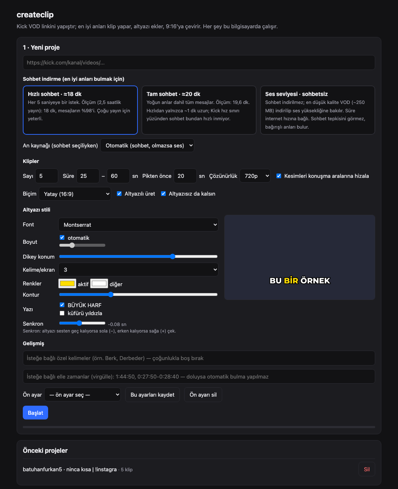
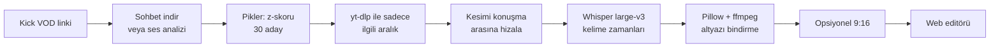

# createclip

**Kick VOD ya da biten bir YouTube yayınının linkini yapıştır → en iyi anları bulsun, klipleri kessin, Türkçe kelime kelime altyazı bassın, istersen 9:16'ya çevirsin.**
Her klip web arayüzünde düzenlenebilir. Her şey yerelde çalışır (Apple Silicon Mac), buluta video veya ses yüklenmez.

> *Paste a Kick VOD or finished YouTube live-stream link → finds the best moments from chat activity, cuts clips, burns word-by-word Turkish captions
> (local Whisper) and can reframe to 9:16. Local web editor + CLI.*



## Özellikler
- **An bulma:** sohbet yoğunluğu (eşsiz sohbetçi sayısı, emote'lara düşük ağırlık, yayının ortalamasına göre z-skoru) ya da ses seviyesi.
- **Altyazı:** `mlx-whisper large-v3` ile kelime zamanlı Türkçe altyazı; aktif kelime vurgulu, 3 font, renk/kontur/boyut/konum ayarı, küfür maskesi.
- **9:16:** bulanık arka plan, tek pencere, iki pencere (üst/alt); pencereleri kareye tıklayarak elle seçersin.
- **Üretmeden önce ayar + canlı önizleme**, ön ayar kaydetme (ör. "Shorts").
- **Düzenlenebilir klipler:** kesimi ±1 sn ayarla, metni düzelt (zamanlama korunur), senkron kaydırıcısı, klip ekle/sil, skora göre sıralama.
- Altyazılı **ve** altyazısız sürüm, `.srt` dışa aktarma.

| Altyazı fontları (önizleme) | 9:16 |
|---|---|
|  |  |

## YouTube desteği
Biten YouTube canlı yayınları (ve sohbet tekrarı açık videolar) Kick ile aynı akıştan geçer: `createclip run "https://www.youtube.com/watch?v=…"`.
Sohbet, `yt-dlp`'nin `live_chat` (chat replay) çıktısından tek seferde alınır (112 dk'lık bir yayında ölçüm: 4704 mesaj, 91 sn);
Kick'teki istek sınırı yoktur, hızlı/tam ayrımı da yoktur. Sınırlar: hâlâ süren canlı yayın işlenmez (bitince dene); sohbet tekrarı
kapalı videolarda (YouTube sayfasında "Live chat replay is not available" yazar; yayıncı kapatmış ya da kaldırılmış olabilir) ses
seviyesi yedeği gerekir. Bu yedek tüm videoyu indirdiği için önce **onay istenir** (arayüzde düğme, komut satırında soru ya da
`--audio-fallback`); tahmini boyut ~1,7 MB/dk (yalnızca tahmin). Yedek YouTube'da uçtan uca denenmedi. Bunun yerine `--at` ile elle zaman verilebilir.

## Gereksinimler
`ffmpeg`, `yt-dlp`, `curl` (`brew install ffmpeg yt-dlp`), Python 3.10+. İlk altyazıda
`mlx-community/whisper-large-v3-mlx` (~3 GB) indirilir; ayrı hizalama modeli gerekmez.

## Kurulum
```bash
git clone https://github.com/emirhan-coban/createclip.git
cd createclip && python3 -m venv .venv && ./.venv/bin/pip install -e ".[dev]"
```

## Kullanım
Web arayüzü (önerilen):
```bash
./.venv/bin/createclip serve          # http://127.0.0.1:8765
```
Komut satırı:
```bash
./.venv/bin/createclip run "<kick-linki>" -n 5                        # altyazılı + altyazısız
./.venv/bin/createclip run "<link>" --layout stack --mask-profanity   # 9:16 iki pencere, küfür yıldızlı
./.venv/bin/createclip run "<link>" --at 1:44:50 --at 0:27:50-0:28:40 # elle zamanlar (sohbet gerekmez)
./.venv/bin/createclip run "<link>" --source audio                    # sohbet yerine ses seviyesi
./.venv/bin/createclip run "<link>" --full-chat --size 0.06 --ypos 0.7 --chunk 2 --sync -0.1 --max-height 1080
```
Çıktı `output/<kanal>-<vod>/` altında: `clips/` (altyazısız), `captioned/` (altyazılı), `words/` (`.json`, `.srt`),
`raw/` (kenar payı olan ham kesit), `chat.jsonl` (önbellek), `manifest.json`.

## Sohbet indirme süreleri (ölçüldü)
Kick'in sohbet API'si bir istekte yalnızca ~5 sn'lik pencere verir ve sürekli yaklaşık **1,5 istek/sn**'ye izin verir
(150 sn'lik ölçüm: 1,2 ve 1,5/sn'de hiç `429` yok; 1,8/sn'de 274 istekten 21'i reddedildi). Yani indirmeyi hızlandırmanın yolu
daha hızlı istemek değil, **daha az istemek**. Bu yüzden iki mod var:

| Mod | 2,5 saatlik yayın | 6 saatlik yayın (59 188 mesaj) | Sonuç |
|---|---|---|---|
| **Akıllı** (varsayılan) | ≈ 8 dk (tahmin) | **23,6 dk** (1781 istek) | en iyi 5 an aynı, ilk 10'un 9'u, ilk 30'un 23'ü |
| **Tam** | ≈ 20 dk | **≈ 57 dk** | eksiksiz |
| Ses seviyesi (`--source audio`) | internet hızına bağlı (ölçülmedi) | — | sohbet yok |

Akıllı mod: önce her 8. pencereyi örnekler, sonra en güçlü adayların (en çok 60) ±45 sn çevresini ayrıntılı indirir; anlar yoğun
veriden seçilir. Parametreler gerçek 6 saatlik veride tarandı (istekleri ~%33'e indirirken ilk 10 korundu). Yarıda kalan indirme
(kapanma, uyku, kopma) **kaldığı yerden devam eder**: her istek `chat.log.jsonl` dosyasına eklenir; akıllı ve tam mod aynı
önbelleği paylaşır. Not: 2,5 saatlik değer o yayında ölçülen istek sayısından değil, ölçeklemeden hesaplandı.

## Nasıl çalışır

1. **Sohbet:** Kick'in resmi olmayan API'sinden `curl` ile, hız sınırının altında (≈1,5 istek/sn) indirilir ve istek istek diske yazılır. Bir istek ~5 sn'lik pencere ve en çok ~25
   mesaj döndürür; `cursor` alanı mesaj atlattığı için kullanılmaz. Alınamazsa ses seviyesine bakılır: YouTube'da yalnız ses akışı (112 dk için 38 MB, 13 sn), Kick'te ses-yalnız biçim olmadığından en düşük video (≈1,7 MB/dk); ses seviyesi ölçülür.
2. **Pik:** 10 sn dilimlerde skor, ilk 2 dk / son 1 dk atlanır, pikler ≥90 sn arayla, pencere pikten 20 sn önce başlar (25-60 sn).
3. **Kesim:** yalnız ilgili aralık (±10 sn pay) indirilir; kesim noktaları `silencedetect` ile en yakın konuşma arasına çekilir.
4. **Altyazı:** ipucu (prompt) kullanılmaz: ölçümde uzun ipucu konuşmanın büyük kısmını atlatıyordu (69 yerine 27 kelime).
   İsteğe bağlı kısa `--vocab "Berk, Derbeder"`. Altyazı Pillow ile çizilip ffmpeg `overlay` ile bindirilir (libass gerekmez).
5. **9:16:** ffmpeg ile pencere kırpma / bulanık arka plan; yüz takibi yok, her yayıncının yerleşimi farklı olduğu için pencereler elle ayarlanır.

### Altyazı senkronu
Kayma kaynağı bulundu ve düzeltildi: kelime zamanları üst üste bindiğinde bindirme zaman çizelgesi gecikiyor ve hata klip boyunca
birikiyordu. Artık altyazı durumları sıralı ve çakışmasız üretilir (`captions.build_states`, birim testli). Whisper kelime
zamanları 5 klipte ses başlangıçlarıyla karşılaştırıldı: medyan sapma ±0,09 sn. Kalan ince kayma için senkron kaydırıcısı var
(varsayılan −0,08 sn).

## Geliştirme
```bash
./.venv/bin/python -m pytest -q       # 58 test
```
Dosyalar: `kick.py` (VOD + sohbet), `peaks.py`, `audio_peaks.py`, `clipper.py`, `transcribe.py`, `captions.py`, `layout.py`,
`youtube.py`, `sources.py` (YouTube + platform seçimi), `watch.py` (izleyici + kuyruk), `review.py` (onay kutusu + hazır paket), `ytdlp.py`, `log.py`, `pipeline.py` (iş akışı + düzenleme), `web/` (FastAPI + tek sayfa arayüz), `syncfix.py` (senkron ölçüm aracı).

## Klip kanalı akışı (izleyici, kuyruk, onay kutusu)
```bash
./.venv/bin/createclip channels add kick.com/kanal -n 5 --layout blur --max-height 1080   # ya da youtube.com/@kanal
./.venv/bin/createclip watch --every 6          # tara + işle + bekle (gece açık bırak); --once: bir kez
./.venv/bin/createclip queue                    # durum; queue retry|confirm|rm <id>, queue clear
./.venv/bin/createclip serve                    # http://127.0.0.1:8765/inbox  → onay kutusu
```
- **İzleyici:** kanalın biten yayınlarını `yt-dlp` ile listeler (Kick: `kick.com/<kanal>/videos`, YouTube: `/@kanal/streams`),
  canlı/süresi 0 olanları ve `--min-minutes`'tan kısaları atlar, **yeni olanları** kuyruğa koyar. Kanalı ilk eklediğinde yalnızca en yeni
  `--backfill` kadar yayın girer (tüm geçmiş değil). En eski önce işlenir: Kick resmi yardım sayfasına göre yayınları 7 gün (doğrulanmış
  kanalda 30 gün) saklıyor, bu yüzden tarama aralığını bundan kısa tut (üçüncü taraf kaynaklar süreyi farklı veriyor).
- **Kuyruk** (`output/queue.json`): durdurup başlatınca kaldığı yerden devam eder; hata 3 kez denenir; sohbet yoksa iş **"onay bekliyor"**
  olur (tüm sesi indirmeden önce sorar), `queue confirm <id>` ya da arayüzdeki düğme.
- **Onay kutusu** (`/inbox`): tüm projelerin klipleri skora göre; **A** onayla, **R** reddet, **S/J/K** gezin. Başlık/açıklama/etiket
  önerisi kural tabanlıdır (ilk cümle, kaynak bağlantısı + zaman damgası, sık kelimeler; model kullanılmaz) ve düzenlenebilir.
  Onaylanan klip **hazır pakete** aktarılır: `ready/<tarih>/<proje>_<klip>/` içinde `video.mp4`, `baslik.txt`, `aciklama.txt`,
  `etiketler.txt`, `kapak.jpg`; platform sınırı/dikey değil uyarısı verir. **Otomatik yükleme yoktur** (YouTube'da denetimsiz API
  projelerinin yüklemeleri özel kalır, TikTok'ta denetimsiz istemci yalnızca özel hesaba paylaşır; bunlar üçüncü taraf kaynaklardan, denenmedi).
- **Kanal profili:** bir klibin altyazı stilini ve 9:16 yerleşimini editörde bir kez ayarla, klip kartındaki **Kanal profili yap** ile
  o yayıncının sonraki tüm klipleri bu ayarla çıksın.

> **Yeniden kullanım uyarısı.** YouTube, Ekim 2026'da Shorts önerilerini değiştirip başkasının klibini katkısız yeniden yükleyen kanalların
> erişimini düşüreceğini duyurdu (ve "yalnızca sesli anlatım, küçük kurgu, şablonlu toplu düzenleme" özgün sayılmıyor). Yeniden kullanım
> politikası izin alınsa bile geçerli ve kanal düzeyinde değerlendiriliyor. Bu araç kesim/altyazı/yerleşim otomasyonudur; kanalın
> özgün katkısını (yorum, bağlam, derleme) senin eklemen gerekir. Ayrıntı ve güncel kurallar için YouTube Yardım'ı oku; bu hukuki tavsiye değildir.

## Özgün katkı araçları, ses ve temizlik

YouTube'un Ekim 2026 Shorts güncellemesi, başkasının klibini katkısız yeniden yükleyen kanalların erişimini düşürüyor
(kaynak: üçüncü taraf özetleri; resmi sayfayı yayından önce kontrol et). Bu yüzden klibe kendi katkını eklemek için araçlar var.
Hiçbiri "politikaya uyar" garantisi değildir.

- **Sohbet tepkisi** (`--reactions` ya da editörde Ekler): o anda yayına yazılan gerçek mesajlar videoda görünür
  (komutlar, çok uzun mesajlar, tekrarlar ve çok sık mesajlar elenir).
- **Başlık kartı**: ilk 3 saniyede klibin ne hakkında olduğunu söyleyen kart.
- **Yorum sesi**: editörde klip oynarken mikrofona konuş (kulaklık tak); kayıt klibe karıştırılır, sen konuşurken orijinal ses kısılır.
- **Derleme**: Onay kutusunda "Günün en iyi anları derlemesi" ya da `createclip compile -n 5`. Açılış kartı, geri sayım kartları,
  klipler; kaynak yayın ve zaman damgası listesi yanında `.txt` olarak çıkar (`ready/derleme/`).
- **Yüz takibi** (`--layout face`): OpenCV (Haar) ile yayıncının yüz kamerasını bulur; üstte oyun, altta yakın yüz.
  Bulunamazsa bulanık arka plana döner. Ölçüm: tek bir yayıncının 12 klibinin 12'sinde bulundu (0,87-0,89 / 0,74-0,77 konumunda),
  klip başına ~1,5 sn. Başka yayıncılarda denenmedi; yan profil, kapalı yüz ve değişen kamera yerleşimi sorun çıkarabilir.
  Kurulum: `pip install 'opencv-python-headless<5'` (5.x sürümünde yüz bulucu yok).
- **Ses seviyesi**: yeni kesimler -16 LUFS'a yaklaştırılır (tek geçişli loudnorm). Ölçüm: 5 klipte seviye farkı 3,9 LU'dan 2,0 LU'ya indi.
- **Ölü sessizlik**: klip uzun bir sessizlikle başlıyor/bitiyorsa baş/son kırpılır (ses ve görüntü birlikte).
- **Benzer klipler**: aynı anın iki kez bulunması ya da farklı projelerde benzer konuşma "benzer klip" etiketiyle işaretlenir.
- **Başlık önerisi (isteğe bağlı)**: `ANTHROPIC_API_KEY` ayarlıysa Onay kutusunda "Claude ile öner" düğmesi çıkar; yalnız o düğmeye basınca
  klibin konuşma metni Anthropic'e gönderilir. Anahtar yokken yerel, basit öneri kullanılır. Gerçek API ile bu oturumda denenmedi
  (yalnız sahte yanıtla test edildi).
- **İptal**: çalışan iş, alttaki çubuktan iptal edilir; çalışan ffmpeg/yt-dlp süreci öldürülür (konuşma çözme sürerken bir sonraki adımda durur).
- **Bildirim**: izleyici ve web işleri bitince macOS bildirimi çıkar.
- **Temizlik**: `createclip cleanup` neyin silineceğini gösterir, `--yes` ile siler. Yalnız yeniden üretilebilir dosyalar
  (ham kesit, kare, ses indirmesi, reddedilen klipler); klipler ve sohbet kaydı kalır. `createclip keep <proje>` ya da arayüzde "Koru" ile
  bir proje temizlik ve silmeden tamamen korunur; son N günde değişen projelere dokunulmaz.

Yapılmayanlar: otomatik YouTube/TikTok/Instagram yükleme (API'ler denetim gerektirir, "hazır paket" kullan) ve ek an sinyalleri
(kahkaha/anahtar kelime): etiketli veri olmadan iyileşme ölçülemediği için eklenmedi.

## Günlük ve hata ayıklama
Her şey `output/createclip.log` dosyasına yazılır (dönen dosya): çalışan her dış komut, çıkış kodu, süre ve hata çıktısının sonu.
Web'de ilerleme çubuğunun altındaki **Günlük** bölümü işin satırlarını canlı gösterir; 2 dk ilerleme olmazsa "takılmış olabilir"
uyarısı çıkar. Komut satırı: `createclip run … -v` (günlüğü ekrana da yazar), `createclip logs -n 100`.

Bilinen takılmalar ve çözümleri (bu makinede gerçekten yaşandı): (1) `yt-dlp`'nin varsayılan bağlantısı "Downloading webpage"de
sonsuza dek bekleyebilir; kod `--impersonate chrome` kullanır (`createclip/ytdlp.py`), 3 dk zaman aşımı vardır.
(2) Whisper modeli diskte olsa da Hugging Face'e güncelleme sorusu IPv6'da takılabilir; önbellekteki model çevrimdışı yüklenir.

## Görüntü kalitesi
YouTube'da ≤720p tek parça (ses+video birlikte) yalnızca 360p'dir; eski seçici bu yüzden 360p indiriyordu (ölçüldü: biçim 18, 640×360).
Artık H.264 ayrı video+ses akışları birleştirilir (denendi: 720p60 → 1280×720 60 fps h264+aac, görüntü/ses süreleri eşit; Kick'te
720p60/1080p60). Dikey (9:16) yerleşimde kaynak kırpılıp büyütüldüğü için 1080p önerilir (arayüz uyarır). Klip iki kez yeniden kodlanır
(kesim crf 18, altyazı bindirme crf 20); bunun görsel etkisi ölçülmedi.

## Sınırlar
- Kick sohbet API'si resmi değil; değişirse kırılabilir. VOD'lar Kick'te süreli saklanır.
- Altyazılar yaklaşık: özel isimler yanlış çıkabilir; web'de düzeltip yeniden bas. Kesimi değiştirirsen konuşma yeniden çözülür,
  metin düzeltmelerin sıfırlanır.
- Ses yedeği yalnızca ölçüm adımı gerçek dosyada denendi; tam VOD ile uçtan uca çalıştırılmadı.
- Kick'in CDN'i zaman zaman takılır: indirme 4 dk zaman aşımı ve 3 deneme ile korunur.
- Küfür filtresi yalnızca yaygın kök listesine bakar. İş durdurma (iptal) henüz yok.
- Yalnızca kendi içeriğin ya da izin aldığın yayınlar için kullan.

## Lisans
MIT (bkz. `LICENSE`). Paketlenen fontlar SIL OFL 1.1 (`createclip/fonts/README.md`).
